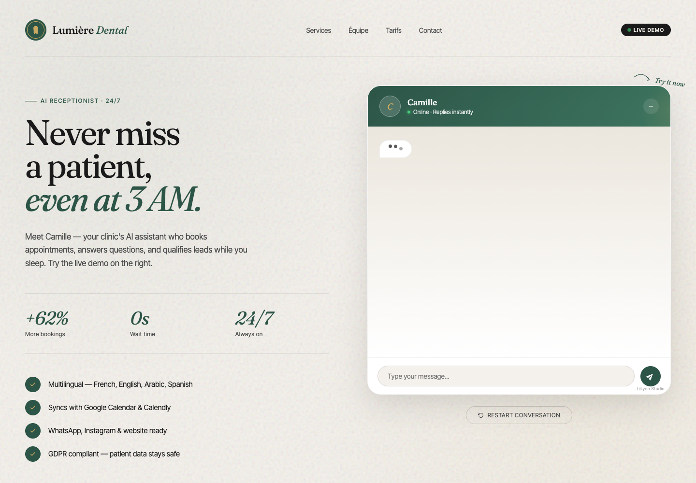

# Lumière Dental

Scripted receptionist conversation; treatment choices; appointment slot selection; conversation restart and typing indicators.

## Implemented features

- Scripted receptionist conversation.
- treatment choices.
- appointment slot selection.
- conversation restart and typing indicators.

## Technology stack

HTML5, CSS, and browser JavaScript.

## Architecture

The original single-page frontend contains its styles and interaction logic. A development-only Node HTTP server serves the original filename at `/`. No backend or build pipeline is required.

## Installation

Install Node.js 22 or later. From this directory:

```sh
npm ci
cp .env.example .env
```

The Node project has no external dependencies. `npm ci` verifies the lockfile without downloading runtime packages.

## Local development

```sh
npm run dev
```

Open `http://127.0.0.1:4173/`. The preview binds to loopback. External requests made by serverless handlers are disabled by default. Browser-loaded fonts and CDN modules still require internet access.

## Configuration

Settings are listed in `.env.example`. `.env` is ignored by Git. Existing production domains and callback defaults in source files are preserved. The local server is development support and does not change deployment configuration.

## Testing

```sh
npm test
```

The suite validates source syntax and applicable handler response contracts without network access. See `VALIDATION.md` for actual execution results and untested functionality. There is no application bundling step in the source project.

## Scope and limitations

Responses and appointment choices are scripted in the browser. There is no model inference, appointment persistence, calendar integration, or real booking service.

## Screenshots and live demo

Local browser captures, when recorded, are listed in `VALIDATION.md`. No hosted deployment is created by this extraction.

## Source and licensing

Original application sources were copied without rewriting them. Existing brand names and notices are preserved. No new redistribution license is granted by this staging copy. Remote fonts and libraries remain supplied by their original hosts under their own terms. No third-party binary dependency has been vendored.



[Mobile preview](docs/mobile.png)

[Existing live frontend](https://liliyon.fr/lumie_re_dental_clinic___ai_assistant_demo) — HTTP 200 and expected page title verified on 2026-10-25. Hosted model responses, transactions, and notifications were not tested.
